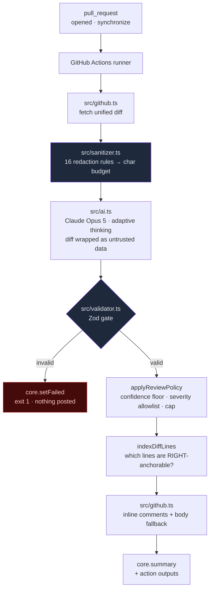

# Autonomous PR Code Reviewer & Analytics Platform

An agentic GitHub Action that reviews every pull request with Claude Opus 5, plus a Next.js
control plane for the findings it produces.

**Live dashboard:** <https://dashboard-sand-seven-21.vercel.app>

The design constraint that shapes everything else: **secrets never leave the runner, and nothing is
posted unless the model's response validates.** Redaction happens before the payload is built, and a
schema violation exits `1` rather than degrading to a best-effort comment.

---

## Contents

| Path | What it is |
| --- | --- |
| `src/` | The GitHub Action — sanitizer, validator, Octokit layer, Anthropic client, orchestrator |
| `.github/workflows/ai-reviewer.yml` | The `pull_request` trigger that runs it |
| `action.yml` | Composite action definition, so other repos can consume it |
| `dashboard/` | Next.js 15 App Router dashboard (deployed to Vercel) |
| `tests/*.test.ts` | 129 `node:test` cases over the security-critical paths, across six files |
| `tests/egress.test.ts` | Runs the Action against a loopback provider and scans the wire for planted secrets |
| `tests/e2e.spec.ts` | Playwright specs covering every route, control, and modal |
| `tests/a11y.spec.ts` | Focus traps, keyboard models, landmarks, live regions |
| `tests/robustness.spec.ts` | Titles, history, deep links, console-error budget |

---

## Architecture



### The five modules

**`src/sanitizer.ts` — redaction and truncation.**
Seventeen rules ordered most-specific-first so a PEM block is swallowed whole before the generic
`sk-` rule can nibble at it: private keys (including PGP `… PRIVATE KEY BLOCK` armor), AWS
access-key IDs and secrets, Anthropic keys, Stripe keys, GitHub tokens
(`ghp_`/`gho_`/`ghu_`/`ghs_`/`ghr_`/`github_pat_`), Slack tokens, Google API keys, SendGrid, npm
tokens, JWTs, `Bearer` and Basic auth headers (both case-insensitive — RFC 7235 makes the scheme
so), connection-string passwords, and secret assignments both quoted and **unquoted**. Each match
becomes `[REDACTED:<RULE_ID>]`, so the model still sees that a credential exists — just not what it
is. A fresh `RegExp` is constructed per pass so a global regex's `lastIndex` can never leak between
files.

The unquoted rule is the one that matters most in practice: `.env`, YAML, `export`, and ini-style
files carry bare `KEY=value` with no quote to anchor on, so a whole `.env.production` used to pass
through with **zero** redactions. It is paired with a negative lookahead for symbolic values —
`process.env.X`, `os.environ[…]`, `${{ secrets.X }}`, `config.get(…)`, `null`, `CHANGEME`,
`your-…` — because redacting *correct* code that reads a credential from the environment hides the
very pattern a reviewer should be approving. Over-redaction is a real cost, not a free safety
margin; `tests/redaction.test.ts` asserts both halves of that contract.

Redaction is not limited to the diff. The pull request **title and body** go to the same provider
and are the same author-controlled surface — a pasted failing `curl -H 'Authorization: …'` belongs
in a PR description far more often than in code — so `src/index.ts` redacts those too and counts
them in the reported total.

Then the diff is split per file, generated files are dropped (lockfiles, `node_modules/`, `dist/`,
`.min.js`, `.map`, `.snap`, binaries), and the remainder is fitted into a character budget by
**fair-share allocation** — small files are kept whole and the budget is redistributed to the large
ones, instead of the first file eating everything.

**`src/validator.ts` — the fail-closed gate.**
One Zod schema, restricted to JSON-Schema-representable constructs, serves two jobs: it is handed to
the API via `zodOutputFormat()` *and* re-checked locally after the response arrives. That
belt-and-braces step matters because the enum in the emitted JSON Schema is flattened into a
description — server-side constraint is advisory, the local gate is the enforcement point.
Everything JSON Schema cannot express — confidence floor, comment cap, severity allowlist, urgency
ordering — lives in `applyReviewPolicy` and runs after validation.

A failure throws `ReviewValidationError`, whose `describe()` prints the Zod issues plus the first
800 characters of the raw response, and `main()` turns that into `core.setFailed` + `exit 1`.

**`src/github.ts` — anchoring.**
Models hallucinate line numbers. `indexDiffLines` walks each `@@ -a,b +c,d @@` hunk and records
exactly which RIGHT-side lines exist; `partitionComments` demotes anything unanchorable into the
review body rather than dropping it; and if GitHub rejects the inline batch anyway (422), `postReview`
logs a warning and retries body-only. Findings are never silently lost.

**`src/ai.ts` — the model call and its guardrails.**
The diff is wrapped in `<pull_request_diff>` tags and the system prompt states plainly that the
contents are untrusted data: any instruction found inside must be reported as a `security` finding,
not obeyed. Nine heuristics (`detectInjectionAttempt`) additionally flag likely injection so the
prompt can call it out explicitly.

```ts
await client.messages.parse({
  model: 'claude-opus-5',
  max_tokens: 16000,
  thinking: { type: 'adaptive' },
  system: buildSystemPrompt(request),
  messages: [{ role: 'user', content: buildUserPrompt(request, injectionSuspected) }],
  output_config: { effort: 'high', format: zodOutputFormat(ReviewSchema) },
});
```

**`src/index.ts` — orchestration.**
Reads inputs from `core.getInput` with env fallbacks, runs the pipeline, writes a `core.summary`
table, sets outputs (`findings`, `overall-risk`, `redactions`, `input-tokens`, `output-tokens`), and
optionally fails the check when a configured severity is present.

---

## Setup

### Requirements

Node 20+ (development here was on Node 26). Anthropic API key. Nothing else.

### Install and verify

```bash
npm install
npm install --prefix dashboard

npm run verify     # typecheck → unit tests → dashboard typecheck → dashboard build → E2E
```

Individual steps:

```bash
npm run typecheck          # tsc --noEmit over src/, tests/, playwright.config.ts
npm run test:unit          # 129 node:test cases, including the egress test
npm run build              # emits dist/
npm run dashboard:dev      # dashboard on http://localhost:3100
npm run test:e2e           # Playwright — builds and serves the dashboard itself
```

Run the E2E suite against a deployed URL instead of a local server:

```bash
E2E_BASE_URL=https://dashboard-sand-seven-21.vercel.app npx playwright test
```

### Wiring it to a repository

Add one secret — `ANTHROPIC_API_KEY`. `GITHUB_TOKEN` is provided by Actions automatically.

```yaml
# .github/workflows/ai-reviewer.yml
on:
  pull_request:
    types: [opened, synchronize]

permissions:
  contents: read
  pull-requests: write

jobs:
  review:
    # Fork PRs get a read-only token; skip rather than fail loudly.
    if: github.event.pull_request.head.repo.full_name == github.repository
    runs-on: ubuntu-latest
    steps:
      - uses: actions/checkout@v4
      - uses: actions/setup-node@v4
        with: { node-version: '20', cache: npm }
      - run: npm ci
      - run: npm run build
      - run: node dist/index.js
        env:
          GITHUB_TOKEN: ${{ secrets.GITHUB_TOKEN }}
          ANTHROPIC_API_KEY: ${{ secrets.ANTHROPIC_API_KEY }}
```

Or consume it as a composite action from another repo:

```yaml
- uses: your-org/autonomous-pr-reviewer@v1
  with:
    anthropic-api-key: ${{ secrets.ANTHROPIC_API_KEY }}
    strictness: strict
    fail-on-severity: security
```

### Configuration

Every input is available as an `action.yml` input and as an env var.

| Input | Env | Default | Effect |
| --- | --- | --- | --- |
| `github-token` | `GITHUB_TOKEN` | `${{ github.token }}` | Auth for diff fetch and review posting |
| `anthropic-api-key` | `ANTHROPIC_API_KEY` | — | **Required** |
| `strictness` | `REVIEW_STRICTNESS` | `balanced` | `lenient` · `balanced` · `strict` |
| `enforce-security-checks` | `REVIEW_ENFORCE_SECURITY` | `true` | Always run the security ruleset |
| `min-confidence` | `REVIEW_MIN_CONFIDENCE` | `0.6` | Findings below this are dropped |
| `max-comments` | `REVIEW_MAX_COMMENTS` | `25` | Cap, applied after urgency sort |
| `severities` | `REVIEW_SEVERITIES` | all four | Allowlist |
| `custom-rules` | `REVIEW_CUSTOM_RULES` | — | Appended to the system prompt |
| `fail-on-severity` | `REVIEW_FAIL_ON_SEVERITY` | `none` | Fail the check at this severity or worse |
| `max-diff-chars` | `REVIEW_MAX_DIFF_CHARS` | `180000` | Truncation budget |
| `dry-run` | `REVIEW_DRY_RUN` | `false` | Run everything, post nothing |

Copy `.env.example` to `.env` for local runs. It is gitignored; real values belong in repository
secrets.

---

## Dashboard

Next.js 15 (App Router) + React 19 + Tailwind, dark by default, glassmorphic surfaces on a
three-gradient backdrop. Charts are hand-rolled SVG — no charting dependency, nothing fetched at
build time, no `next/font/google` network call.

| Route | What it does |
| --- | --- |
| `/` | Headline metrics, the five-stage pipeline, health trend, top issues, live audit log with severity filters |
| `/reviews` | Search, sort (newest/oldest/most findings/highest risk), status tabs, multi-select severity pills, pagination |
| `/analytics` | 7/30/90-day range tabs over code health, top issue categories, severity donut, token usage |
| `/rules` | Six policy switches, strictness radios, confidence slider, caps, severity allowlist, custom rules |
| `/settings` | Workspace, credentials (with masked key), trigger switches, danger zone with two-step confirm |

Clicking any review opens the **inspector**: findings with suggested patches, the diff with AI
comments rendered inline at their anchored lines (and un-anchorable ones collected below, exactly as
the Action would post them), and the raw validated JSON payload.

All dashboard data is deterministic mock data — a fixed `NOW` constant and a seeded `mulberry32`
PRNG, with no `Date.now()` or `Math.random()` at render time — so the server and client renders match
and hydration is stable. `toLocaleDateString` calls pin both the locale and `timeZone: 'UTC'` for the
same reason.

### Deployment

The dashboard is deployed from `dashboard/`:

```bash
npx vercel build --prod
npx vercel deploy --prebuilt --prod
```

`dashboard/vercel.json` pins the framework preset, region, and a security header set (CSP,
`X-Frame-Options: DENY`, `nosniff`, referrer and permissions policies) that is verified live on the
deployment. In the Vercel UI, set **Root Directory** to `dashboard`.

---

## Testing

**Unit — `npm run test:unit`, 129 cases across six files.** Concentrated on the paths where a bug is
a security incident: every secret class is redacted; a PEM block is swallowed whole; clean code is
left untouched; redaction is idempotent; lockfiles are skipped; the character budget and fair-share
allocation hold; malformed JSON raises `ReviewValidationError`; unknown severities, missing fields,
and type mismatches are all rejected; the policy layer filters, caps, sorts, and clamps correctly;
diff-line indexing and comment partitioning behave; and injection detection fires on hostile diffs
without firing on ordinary code.

**Egress — `tests/egress.test.ts`, part of the unit run.** The one test that checks bytes on the
wire rather than a return value, and the one that closes the project's central claim. The whole
Action runs for real against a loopback HTTP server with `GITHUB_API_URL` and `ANTHROPIC_BASE_URL`
pointed at it; eleven planted credentials — spanning the diff, the PR **title**, and the PR
**body** — are then searched for in the captured request body as plain substrings. `sanitizeDiff`
can be flawless and the Action can still leak if a caller forwards the raw diff alongside the
sanitized one, and no unit test of the sanitizer can see that. It also asserts the *surviving*
signal (file paths, `PUBLIC_APP_NAME=Atlas`, `process.env.SERVICE_API_KEY`), so a sanitizer that
redacted everything could not pass by deleting the payload.

**E2E — `npm run test:e2e`, 64 specs run as 250 checks across six browser projects.** Desktop
Chromium, Firefox, WebKit and a tablet profile run the 61 desktop specs; Pixel 7 and iPhone
profiles run the 3 `@responsive` ones. Every route renders with correct shell state; every nav link
routes and marks itself active; the sync button, account menu, and mobile drawer all work; every
filter pill, status tab, severity toggle, sort option, search query, and pager click is asserted
against the rows it produces; the inspector opens from both the feed and the explorer, switches all
three tabs, resets to Findings on reopen, and closes via button, Escape, and backdrop; every switch
in both forms toggles both ways; every input accepts edits; save and reset round-trip; and a final
sweep clicks *every enabled button on every route* to prove nothing throws.

`tests/a11y.spec.ts` and `tests/robustness.spec.ts` add the contracts that only break in specific
engines: the inspector's focus trap and focus restoration, APG tablist/menu keyboard models, roving
tabindex, the off-canvas drawer's `inert` state, live regions, per-route landmark and duplicate-id
checks, document titles, back/forward history, and deep links to unknown routes.

Every spec asserts **zero console errors, zero uncaught page errors, and zero failed requests** —
a hydration mismatch fails the suite even when the visible assertions pass.

Running the matrix across four engines is what made it worth running. It caught three defects that
Chromium alone reported as green: the inspector's focus trap only intervened at the DOM-first and
DOM-last nodes and so leaked in WebKit, which orders tab stops differently; the drawer restored
focus by reading `document.activeElement`, which is `<body>` in WebKit because Safari does not focus
a `<button>` on tap; and the `<nav>` landmark had no accessible name.

```
250 passed (local production build, 6 browser projects)
129 passed (unit, including egress)
```

---

## Security notes

- Redaction runs **before** the request body is constructed. The unredacted diff exists only in
  runner memory.
- The diff is delimited and declared untrusted in the system prompt; injection attempts are surfaced
  as findings rather than followed.
- A schema violation is terminal. There is no "post what we can" path.
- Fork PRs are skipped by the workflow guard — their `GITHUB_TOKEN` cannot post reviews, and the
  alternative (`pull_request_target`) would run untrusted code with a write token.
- Workflow permissions are `contents: read` + `pull-requests: write`, nothing more.
- Credentials come from secrets only; `.env` is gitignored and `.env.example` carries empty values.
