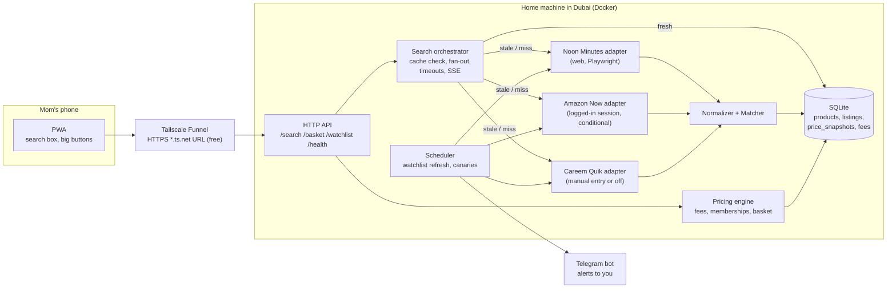
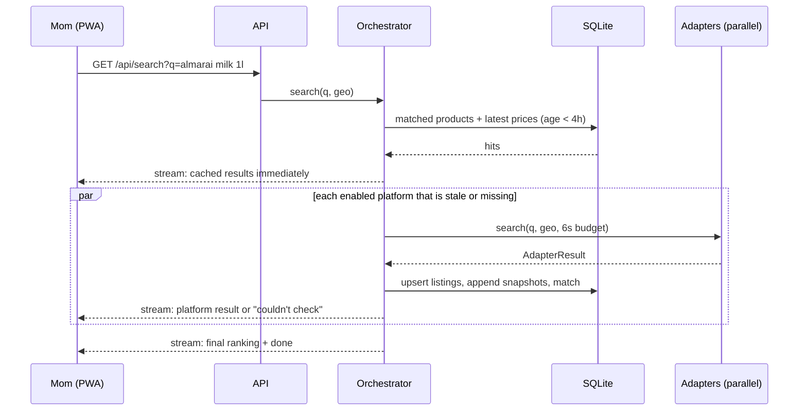

# Grocery Price Compare — Architecture & Plan

**Goal:** Mom types one product ("Almarai milk 1L"). The system checks **Noon Minutes, Careem Quik and Amazon Now** for her Dubai address, tells her where it's cheapest, and opens that app so she can buy it.

**Constraints (decided):**
- **Mom-only.**
- **$0 running cost.**
- **Dubai.**
- **New dedicated repo** when the build starts.

See §15 for every decision and why.

**Status:** Design done. The Phase 0 web probe is done (see [`PHASE0_FINDINGS.md`](./PHASE0_FINDINGS.md)). The manual checks and the value survey are **not done yet**. The build backlog is in [`BUILD_PLAN.md`](./BUILD_PLAN.md).

> **Phase 0 result in one line:** only Noon Minutes is reachable on the web without login. Amazon Now needs sign-in to browse. Careem Quik is app-only. On the free, low-risk path, v1 compares Noon vs Amazon at best. Careem is a pending decision (PHASE0 §3.3).

---

## 0. Risks that decide whether this works

| # | Risk | Why it matters | Mitigation |
|---|------|----------------|------------|
| R1 | **There's no API to connect to.** None of the 3 platforms publishes a consumer price API. Amazon PA-API 5 was retired 2026-05-15, and its successor (the Creators API) is an affiliate tool with no known Amazon Now coverage. | Data comes from public web pages, logged-in sessions or by hand. | Adapter interface that doesn't care where data comes from (§4). The access route for each platform is settled in Phase 0 (§11). |
| R2 | **ToS and legal exposure.** Platform ToS very likely forbid automated access. Amazon's Conditions of Use explicitly do. UAE Federal Decree-Law No. 34 of 2021 covers unauthorized access to information systems. Reading public pages is a grey area. Getting around logins, anti-bot or app pinning is riskier. *Not legal advice.* | For a personal tool, the realistic cost is **a banned account**. | Public pages only where possible. Respect robots.txt. Low volume. **Never automate mom's real accounts.** |
| R3 | **Prices and stock depend on location.** Dark stores carry different stock, and maybe different prices. Noon's web pages show prices with **no address set**. | A price from a different zone is wrong for mom. | PHASE0 §4 step 2 checks whether the address changes Noon's prices. Every fetch is tied to a `zoneId`. |
| R4 | **The cheapest item isn't always the cheapest order.** Fees and memberships (Prime, noon One, Careem Plus) flip results. Amazon Now: free over AED 25 for Prime, otherwise AED 6. | Showing only shelf prices will mislead her. | Fee schedules + her memberships feed the pricing engine (§7). |
| R5 | **Matching is the hard part.** Real Noon data contains ads, combo bundles and size strings like `Packaging May Vary4x1L`. | A wrong match means a false "cheapest". | Rule-based parser, combo exclusion, **human-confirmed watchlist** (§6). |
| R6 | **Silent adapter failure.** | The tool quietly lies. | Every platform's status is always shown, plus a daily canary with a Telegram alert to you (§10). |
| R7 | **Value unproven.** | Upkeep may cost more than it saves. | Value gate in PHASE0 §4: under AED 15/week → stop. |
| R8 | **Scope is narrow.** Talabat Mart and Deliveroo HOP were excluded on purpose, and Careem may drop out (R1). | "Cheapest" only means cheapest among the apps we checked. | The UI always says which apps were compared. |

---

## 1. Scope

**In (v1)**
- One user (mom), one Dubai address.
- Search → per-platform price, stock, "cheapest" badge, a deep link to the app.
- A watchlist of her usual items, refreshed on a schedule. Search is instant for what she actually buys.
- Delivery fees and her memberships.

**In (v2)**
- Basket compare.
- Price-drop alerts.
- Voice input polish.

**Out**
- Ordering or checkout inside our app (deep-link only).
- Multiple users, public launch.
- Anything with a recurring cost: paid data feeds, paid LLM calls, paid browser agents, paid hosting.

---

## 2. System overview



**Key decisions**
1. **A single program, split into modules, on one home machine.** One user, three sources. Nothing more is justified.
2. **Home machine, not the cloud.** Noon's Cloudflare blocked a US cloud IP but let a UAE IP through (PHASE0 §2.1). A Dubai home connection is the most reliable vantage point, and it's free. Fallback is an Oracle Cloud Always Free VM (more likely to be blocked).
3. **Tailscale Funnel** gives mom a public HTTPS URL (`https://<machine>.<tailnet>.ts.net`) without opening router ports. It's free on Tailscale's personal plan (**verify at setup**). Access is gated by an unguessable link token stored in her installed PWA. *Why not Cloudflare Tunnel + Access?* A stable named tunnel and Access both need a domain you own on Cloudflare (~USD 10/yr), which breaks the $0 rule. Use it only if you already own a domain.
4. **SQLite.** One user, one process, one file to back up. FTS5 with the `trigram` tokenizer gives **substring** search ("mara" finds "Almarai"). It does **not** tolerate typos. Typo tolerance ("almari") is done in app code by comparing trigram overlap on the candidate set. No Postgres, no Redis, no Supabase (its free tier pauses inactive projects).

---

## 3. Core design choice: watchlist-first, search-second

Mom probably buys 50–150 repeat items (**UNVERIFIED**, take this from her order history).

| | Live search per query | Watchlist-first (chosen) |
|---|---|---|
| Latency | 3–15 s | < 300 ms from SQLite |
| Requests to platforms | Every search × 3 | ~150 items × 2–3 platforms × 2–3/day ≈ 600–1,350/day, spread out |
| Ban risk | Bursty | Low, steady |
| Match quality | Automatic, error-prone | **Human-confirmed once** |
| Adapter down | No result | Last known price with its age |

Search hits SQLite first. A miss or stale data triggers a live fan-out. Anything searched for more than twice gets suggested for the watchlist (from `search_log`).

---

## 4. Platform adapter contract

```ts
// packages/core/src/adapter.ts

export type PlatformId = 'noon_minutes' | 'careem_quik' | 'amazon_now';

/** Money is integer fils (AED × 100). Never floats. */
export type Fils = number;

export interface GeoContext {
  lat: number;
  lng: number;
  zoneId: string;          // our bucketing of an address -> dark-store zone
}

export type DataSource = 'web' | 'web_logged_in' | 'app_api' | 'manual' | 'fixture';

export interface RawListing {
  platform: PlatformId;
  platformSku: string;
  title: string;
  brand?: string;
  sizeText?: string;        // as shown, e.g. "6 x 200 ml"
  price: Fils;
  wasPrice?: Fils;
  promoText?: string;       // displayed, NOT auto-applied
  isSponsored: boolean;     // "Ad" tiles in search results
  isBundle: boolean;        // combo packs, excluded from single-item matching
  inStock: boolean;
  imageUrl?: string;
  deepLink?: string;
  gtin?: string;
  fetchedAt: string;        // ISO-8601
  source: DataSource;
}

export interface FeeSchedule {
  platform: PlatformId;
  zoneId: string;
  membership: string | null;      // 'prime' | 'noon_one' | 'careem_plus' | null
  minOrder?: Fils;
  deliveryFee: Fils;
  freeDeliveryThreshold?: Fils;
  smallOrderFee?: Fils;
  smallOrderThreshold?: Fils;
  serviceFeePct?: number;
  checkedAt: string;
  source: 'manual' | 'web';
}

export type AdapterStatus = 'ok' | 'timeout' | 'blocked' | 'login_required' | 'not_serviceable' | 'disabled' | 'error';

export interface AdapterResult<T> {
  platform: PlatformId;
  status: AdapterStatus;
  data: T;
  latencyMs: number;
  error?: string;
}

export interface PlatformAdapter {
  readonly id: PlatformId;
  readonly capabilities: { search: boolean; lookupBySku: boolean };
  search(q: string, geo: GeoContext, signal: AbortSignal): Promise<AdapterResult<RawListing[]>>;
  lookup(skus: string[], geo: GeoContext, signal: AbortSignal): Promise<AdapterResult<RawListing[]>>;
}
```

Fee schedules are **entered by hand and re-checked monthly** (PHASE0 §4 step 5). They change rarely, and scraping checkout pages isn't worth it.

**Rules every adapter must follow**
- Never throw. Return a `status`.
- Respect `AbortSignal`. Budgets: 6 s for live search, 60 s for scheduled runs.
- **Respect robots.txt.** For Noon: HTML pages only, **never** `/_svc/` or `/_serverFn/`.
- Token-bucket rate limit (≤ 1 request per 3–5 s per platform, with jitter), plus a **hard daily cap**.
- Circuit breaker: after 3 consecutive `blocked` or `login_required` results, pause for 6 h and send a Telegram alert.
- Ship with recorded fixtures (`fixtures/*.html`) and contract tests.

### Data sources

| Tier | Source | Status under the $0 constraint |
|---|---|---|
| 1 | Official / partner API | None exist (R1) |
| 2 | Paid data vendor | **Excluded** ($0) |
| 3 | Public web pages via Playwright | **Noon Minutes** |
| 3b | Web pages with a logged-in **throwaway** account | **Amazon Now**, if a non-Prime throwaway account can see prices (PHASE0 §3.2) |
| 4 | Intercepting the app's private API | Careem option A. **Not chosen.** Highest risk. |
| 5 | Manual entry | Careem option B, Amazon fallback |
| — | Paid browser agents (Jev, Firecrawl, etc.) | **Dev/debug only.** Phase 0 probing, diagnosing a broken adapter. Never in the runtime path (cost grows with use, results aren't repeatable). |

| Platform | v1 source | Notes |
|---|---|---|
| Noon Minutes | Tier 3: search page + product pages by SKU | Product URLs are public in sitemaps |
| Amazon Now | Tier 3b or 5 | Decided by PHASE0 §4 step 3 |
| Careem Quik | Off (C) or manual (B) | **Your decision**, PHASE0 §3.3 |

---

## 5. Search flow



Results stream to her phone as they arrive (Server-Sent Events). Every price shows its age. Disabled platforms show "not compared".

---

## 6. Normalization & matching

**Normalizer** (pure functions, unit-tested against the corpus in BUILD_PLAN):
- Size parsing, including the real Noon cases: `1L`, `500ml`, `1 Gallon`, `1Kg`, `4x1L`, `18x125ml`, `(4 x 66g)`, `Packaging May Vary4x1L`, `150g - 8.5g Protein`, `120g - 8 Triangles`. Output: `{ value, unit: 'ml'|'g'|'pc', packCount }`.
- Unit price in fils per 100 ml / 100 g / piece.
- Brand dictionary seeded by hand (Almarai, Al Rawabi, Al Ain, Nadec, Lacnor, MLK, Nestlé…). Prefer the platform's separate brand field over the title.
- Strip noise: "Packaging Disclaimer…", "Promo Pack", "New", "Exclusive", protein claims.

**Matcher**

| Step | Rule | Result |
|---|---|---|
| 0 | `isBundle` (e.g. "… Combo", Noon SKU pattern `V…V-1`) | Excluded from single-item matching |
| 1 | Same barcode (GTIN) | `exact`, auto |
| 2 | Brand equal **and** size equal **and** fat/variant keywords equal **and** trigram Jaccard similarity of the remaining title tokens ≥ 0.6 (computed in app code) | `exact`, auto |
| 3 | Brand + size equal, similarity 0.35–0.6 | `probable` → **human review queue** (you, in an admin screen) |
| 4 | Same category, different brand or size | `alternative`, shown with unit price |
| 5 | Else | No match |

- Variant keywords matter: "Full Fat" ≠ "Low Fat" ≠ "Fat Free", and "Fresh" ≠ "Long Life". A rule that ignores them would match items wrongly.
- No LLM. Ambiguous cases go to you once and the decision is stored.
- Watchlist items are human-confirmed (`match_method = 'human'`).

---

## 7. Pricing engine

**Single item:**
```
shelf_price  = listing.price
landed_price = shelf_price + applicable fees(platform, subtotal = shelf_price, membership)
```
Items are ranked by **shelf price**. When fees would flip the winner for a one-item order, a note says so.

**Basket (v2):**
- Totals per platform, including fees, with missing items flagged.
- Best split across at most 2 platforms. With 3 platforms that's 3 pairs to brute-force, plus a local-search pass for fee thresholds.
- If splitting saves less than AED 5, recommend one platform.

---

## 8. Data model (SQLite)

IDs are app-generated ULIDs (`TEXT`). Timestamps are ISO-8601 `TEXT`. Booleans are `INTEGER` 0/1.

```sql
create table platforms (
  id text primary key,                 -- 'noon_minutes' | 'careem_quik' | 'amazon_now'
  name text not null,
  enabled integer not null default 1
);

create table addresses (
  id text primary key,
  label text not null,                 -- 'home'
  lat real not null,
  lng real not null,
  zone_id text not null
);

create table memberships (
  platform_id text primary key references platforms(id),
  tier text not null                   -- 'prime' | 'noon_one' | 'careem_plus'
);

create table products (                -- canonical, cross-platform
  id text primary key,
  brand text,
  name text not null,
  variant text,                        -- 'full fat', 'low fat', 'long life' ...
  size_value real,
  size_unit text check (size_unit in ('ml','g','pc')),
  pack_count integer not null default 1,
  gtin text,
  category text
);

create table listings (                -- one per platform SKU
  id text primary key,
  platform_id text not null references platforms(id),
  platform_sku text not null,
  title text not null,
  brand_raw text,
  size_raw text,
  is_bundle integer not null default 0,
  image_url text,
  deep_link text,
  product_id text references products(id),
  match_confidence real,
  match_method text check (match_method in ('gtin','rule','human')),
  unique (platform_id, platform_sku)
);

-- substring title search (SQLite >= 3.34); typo tolerance is app-side
create virtual table listings_fts using fts5(title, content='listings', tokenize='trigram');

create table price_snapshots (         -- append-only
  listing_id text not null references listings(id),
  zone_id text not null,
  price_fils integer not null,
  was_price_fils integer,
  promo_text text,
  in_stock integer not null,
  source text not null,                -- 'web' | 'web_logged_in' | 'manual' | ...
  fetched_at text not null,
  quarantined integer not null default 0
);
create index price_snapshots_latest on price_snapshots (listing_id, zone_id, fetched_at desc);

create table fee_schedules (
  platform_id text not null references platforms(id),
  zone_id text not null,
  membership text,
  min_order_fils integer,
  delivery_fee_fils integer not null,
  free_delivery_threshold_fils integer,
  small_order_fee_fils integer,
  small_order_threshold_fils integer,
  service_fee_pct real,
  checked_at text not null
);

create table watchlist (
  product_id text primary key references products(id),
  target_price_fils integer
);

create table search_log (
  id integer primary key,
  q text not null,
  result_count integer,
  platform_status text,                -- JSON: {platform: {status, latencyMs}}
  created_at text not null
);

create table adapter_runs (
  id integer primary key,
  platform_id text not null,
  kind text not null,                  -- 'search' | 'lookup' | 'canary'
  status text not null,
  listings integer,
  duration_ms integer,
  error text,
  created_at text not null
);
```

---

## 9. API surface

| Method | Path | Purpose |
|---|---|---|
| GET | `/api/search?q=` | Stream of per-platform results (SSE) plus final ranking |
| GET | `/api/products/:id` | Canonical product, its listings, latest prices |
| GET/POST/DELETE | `/api/watchlist` | Manage usual items |
| POST | `/api/basket/compare` | v2: `{ items: [{productId, qty}] }` → per-platform totals and best split |
| GET | `/api/platforms/health` | Last run status per adapter |
| GET/POST | `/api/admin/review` | Human match confirm/reject (you) |
| POST | `/api/admin/manual-price` | Manual price entry (Careem option B / Amazon fallback) |

Example final event of `/api/search`:
```json
{
  "query": "almarai milk 1l",
  "compared": ["noon_minutes", "amazon_now"],
  "notCompared": ["careem_quik"],
  "products": [{
    "productId": "01J…",
    "name": "Almarai Fresh Milk Full Fat 1L",
    "offers": [
      { "platform": "noon_minutes", "priceFils": 735, "inStock": true, "ageMin": 40, "source": "web", "deepLink": "https://minutes.noon.com/uae-en/now-product/Z5EA09043DDB8EB12D99FZ-1/" },
      { "platform": "amazon_now",   "priceFils": 750, "inStock": true, "ageMin": 300, "source": "web_logged_in", "deepLink": "…" }
    ],
    "cheapest": "noon_minutes"
  }],
  "alternatives": [{ "name": "MLK Fresh Milk Full Fat 1L", "bestPriceFils": 625, "platform": "noon_minutes" }],
  "platformStatus": { "noon_minutes": "ok", "amazon_now": "ok", "careem_quik": "disabled" }
}
```
(The Noon prices are real Phase 0 samples. The Amazon price is illustrative.)

---

## 10. Reliability & operations

- **Contract tests:** every parser runs against recorded HTML fixtures in CI.
- **Daily canary:** 3 known items per enabled platform. Each must return at least one listing priced between AED 1 and 200. If not, a **Telegram bot** messages you. Mom never sees errors.
- **Sanity quarantine:** a price move over 60% versus the last snapshot, or a price outside the plausible range, is stored with `quarantined = 1` and never ranked.
- **Staleness:**
  - scraped prices under 4 h show normally;
  - 4–24 h show greyed;
  - over 24 h aren't ranked;
  - manual prices: under 7 days show normally with an "entered by hand" badge; older than that aren't ranked.
- **Accounts:** the throwaway Amazon account's session is a Playwright persistent profile on the home machine, outside the repo. **Mom's accounts are never automated.**
- **Backups:** nightly copy of the SQLite file (`.backup`) to a second disk or a free cloud drive.

---

## 11. Phases (details and tickets in [BUILD_PLAN.md](./BUILD_PLAN.md))

| Phase | What | Gate to pass |
|---|---|---|
| **0** | Web probe ✅ · manual checks + value survey ⏳ (PHASE0 §4) | Weekly saving ≥ AED 15 · Careem decision made · Amazon eligibility known |
| **1** | Scaffold + core logic + fixture adapters + PWA on fake data | Mom uses the fake-data version and gets it without help |
| **2** | Real Noon adapter, SQLite persistence, staleness, quarantine | 7 days of canaries green from the home machine |
| **3** | Watchlist import + review screen, scheduler, fees, memberships, Amazon (if eligible) | MVP definition of done (BUILD_PLAN) |
| **4** | Basket compare, price-drop alerts, Careem (if a decision allows it) | Success metrics (BUILD_PLAN) |

---

## 12. Repo layout & stack (new dedicated repo)

```
apps/
  web/              Next.js PWA (static export), served by the server
  server/           Node + Hono: API, orchestrator, scheduler
packages/
  core/             types, money (fils), normalizer, matcher, pricing — pure, no I/O
  adapters/
    noon-minutes/   { adapter.ts, parser.ts, fixtures/ }
    amazon-now/
    careem-quik/    manual-entry adapter (reads manual prices)
    fixture/        fake adapter for dev and demos
  db/               SQLite migrations, typed queries
docs/               these planning docs
docker-compose.yml  server + tailscale sidecar
```

| Concern | Choice | Cost |
|---|---|---|
| Language | TypeScript everywhere | $0 |
| Server | Node 20+ + Hono | $0 |
| DB | SQLite (`better-sqlite3`) + FTS5 trigram | $0 |
| Jobs | In-process scheduler (`croner`) + `adapter_runs` table | $0 |
| Scraping | Playwright (Chromium) | $0 |
| Hosting | Home machine + Docker + Tailscale Funnel | $0 (electricity) |
| Alerts | Telegram bot | $0 |
| LLM | None | $0 |
| Dev-only tools | Firecrawl / browser agents for probing and debugging | Free tier credits only |

---

## 13. UX for mom

- One search box, voice input (Web Speech API), large text.
- **"Cheapest: Noon Minutes — AED 7.35"** with one big "Open in Noon" button.
- Other platforms underneath, each with stock and price age. Manual prices carry an "entered by hand" badge.
- Footer that's always visible: "Compared: Noon Minutes, Amazon Now · Not compared: Careem Quik".
- A "cheaper alternative" section with unit price.
- No logins or settings for her. You set things up once.

---

## 14. Inputs still needed (before Phase 1)

1. Her memberships: Prime / noon One / Careem Plus / none.
2. UI language: English / Arabic / other.
3. Mostly one-item top-ups or weekly baskets?
4. A spare machine at home that can stay on (laptop, Pi, mini-PC)?
5. Her usual items: screenshots of recent orders are enough.
6. The PHASE0 §4 manual checks and value survey.
7. **Careem decision:** option A, B or C (PHASE0 §3.3).

---

## 15. Decisions

| # | Decision | Reason |
|---|---|---|
| D1 | Mom-only, no multi-user | Your call. It keeps auth, privacy and scale out of scope. |
| D2 | $0 running cost, nothing paid | Your call. Rules out vendor feeds, paid LLMs, paid browser agents and paid hosting. |
| D3 | Platforms: Noon Minutes, Careem Quik, Amazon Now | Your call. Talabat Mart and Deliveroo HOP excluded; the UI says which apps were compared (R8). |
| D4 | Dubai only | Your answer. One zone to start with. |
| D5 | New dedicated repo at build start | The current repo is an unrelated project with its own CI. |
| D6 | Watchlist-first, human-confirmed matches | Faster, safer and more accurate than live matching on every search (§3). |
| D7 | Home machine + Tailscale Funnel | Free. A Dubai residential IP passes Noon's Cloudflare where a cloud IP didn't. Cloudflare Tunnel/Access needs a paid domain. |
| D8 | SQLite instead of Postgres/Supabase/Redis | One user, one process. No free-tier pausing. One-file backups. |
| D9 | No LLM in the runtime path | Costs money, and isn't needed once matches are human-confirmed. |
| D10 | Paid browser agents (Jev etc.) are dev/debug only | Cost grows with use and results aren't repeatable (§4, data sources table). |
| D11 | Respect robots.txt. Noon: HTML only, never `/_svc/` | The most defensible position under R2. |
| D12 | Never automate mom's real accounts | Losing her Prime/Careem account costs real money. |
| D13 | Fee schedules entered by hand, re-checked monthly | They change rarely, and scraping checkout pages isn't worth it. |
| D14 | Telegram for operator alerts | Free and instant. Mom never sees errors. |
| D15 | Careem Quik | **Pending.** Recommended: drop from v1 (option C) unless the survey shows it often wins. |

---

### Sources
- Amazon Now launch, fees, coverage: [About Amazon](https://www.aboutamazon.com/news/innovation/amazon-now-delivery-uae), [Gulf Business](https://gulfbusiness.com/en/2025/retail/amazon-launches-amazon-now-service-across-uae/), [Entrepreneur ME](https://mena.entrepreneur.com/growth-strategies/amazon-launches-amazon-now-in-the-uae-promising-delivery/498573)
- PA-API 5 deprecation (2026-04-30) and retirement (2026-05-15): [Amazon Associates](https://affiliate-program.amazon.com/creatorsapi/docs/en-us/paapiv5-deprecation)
- UAE quick-commerce landscape: [Real Estate Club Dubai](https://realestateclubdubai.com/blog/dubai-life/grocery-delivery-in-dubai-2026-comparing-every-app-prices-speed-quality)
- Careem Quik is ordered in the app: [Gulf Business](https://gulfbusiness.com/careem-launches-15-minute-grocery-delivery-service-in-dubai)
- Jev browser agent: [Hermes AI](https://hermes-ai.net/news/browser-use-s-jev-ultrafast-cuts-browser-agent-costs-90-with-indexed-dom-actions/)
- Platform probe evidence: [PHASE0_FINDINGS.md](./PHASE0_FINDINGS.md)
