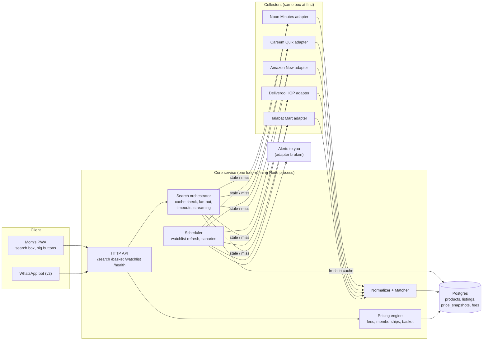
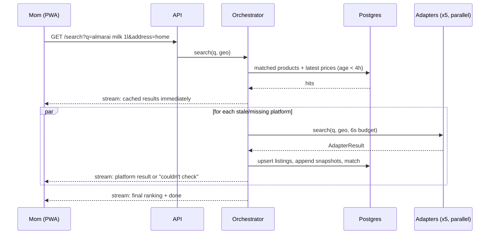

# Grocery Price Compare — Architecture & Plan

**Goal:** Mom types one product ("Al Rawabi milk 1L"). The system checks Noon Minutes, Careem Quik, Amazon Now and Deliveroo HOP (plus Talabat Mart, see §1) and tells her where it's cheapest, then opens that app so she can buy it.

**Status:** Plan only. Nothing here has been validated against the live platforms yet. Anything marked **UNVERIFIED** is an assumption, and Phase 0 is there to check it.

---

## 0. Read this first: what will actually decide if this works

| # | Risk | Why it matters | Mitigation in this plan |
|---|------|----------------|-------------------------|
| R1 | **There are no public APIs to "connect later."** Noon Minutes, Careem Quik and Deliveroo HOP publish no consumer product/price API. Amazon's PA-API 5 was retired on **May 15, 2026**. Its successor, the Creators API, is for Associates (affiliates), and nothing confirms it exposes Amazon Now dark-store stock or pricing (**UNVERIFIED**). | "Connect the API later" assumes something that doesn't exist. The data has to come from scraping, private app APIs or a paid data vendor. | Adapter interface that doesn't care where data comes from (§4). Phase 0 feasibility spike with a go/no-go gate (§11). |
| R2 | **Terms of Service and legal exposure.** The ToS of these platforms very likely prohibit automated access. I have not read each one. UAE Federal Decree-Law No. 34 of 2021 (cybercrime) covers unauthorized access to information systems. Scraping public pages is a grey area. Getting around logins, anti-bot systems or app certificate pinning is clearly riskier. *Not legal advice.* | For personal use the practical risk is mainly an **account ban on mom's real accounts**. If this ever becomes a product, the risk profile changes completely. | Low request volume, watchlist-first design (§3), no use of mom's main accounts for collection, legal review before any commercial use. |
| R3 | **Prices and stock depend on location.** Quick-commerce runs out of dark stores, so what's available (and sometimes the price) depends on the delivery address. | A price fetched for the wrong area is wrong. | Every fetch is tied to a delivery zone (`GeoContext`). |
| R4 | **"Cheapest item" ≠ "cheapest order."** Delivery fees, small-order fees, service fees and memberships (Prime, noon One, Careem Plus, Talabat Pro, Deliveroo Plus) often decide the real winner. Amazon Now: free delivery for Prime members on orders over AED 25, otherwise about AED 6. | Showing only the shelf price will regularly point her to the more expensive option. | Fee schedules plus her memberships go into the pricing engine. Basket mode compares whole orders (§7). |
| R5 | **Product matching is the real engineering problem, not scraping.** "Almarai Full Fat Milk 1L" vs "Almarai Fresh Milk Full Cream 1 Litre" vs "Almarai Milk 4x1L". | A wrong match means a wrong "cheapest" claim. | Size/brand parser, confidence tiers, **one-time human confirmation for her usual items** (§6). |
| R6 | **Silent adapter failure turns the tool into a liar.** If the Careem adapter breaks and results quietly exclude it, "cheapest" becomes false. | Scrapers break every time a site changes its markup. | Each platform's status is always shown ("Careem Quik: couldn't check"), plus daily canaries and alerts to *you*, not mom (§10). |
| R7 | **The value may be small.** I have no data on how far staple prices actually differ between these apps. | If the gap is a few dirhams a week, this costs more in maintenance than it saves. | **Phase 0 includes a manual price survey.** Measure before you build (§11). |

**Missing from your list:** **Talabat Mart** is arguably the biggest quick-commerce grocery player in the UAE. InstaShop and El Grocer are marketplace aggregators. The plan treats platforms as plugins, so adding any of them is just another adapter.

---

## 1. Scope

**In (v1)**
- One user (mom) with one or two saved addresses.
- Search for a product → per-platform price, stock, "cheapest" badge, a button that opens the platform's app.
- Her usual items ("watchlist") are refreshed on a schedule, so search is instant for the things she actually buys.
- Delivery fees and memberships are taken into account.

**In (v2)**
- Basket compare: "my weekly list costs AED X on Noon vs AED Y on Careem".
- Price-drop alerts.
- WhatsApp or voice interface.

**Out (explicitly)**
- Checkout or ordering inside our app. We only deep-link to the platform. Automated ordering multiplies the legal and account risk and adds nothing at this stage.
- Multi-user / public launch (needs a different data strategy, see R2).

---

## 2. System overview



**Key decisions**

1. **Modular monolith, not microservices.** One user, five data sources. Microservices would add ops cost and buy nothing.
2. **Long-running process, not serverless, for collectors.** Headless browsers on Vercel or Lambda are slow to start, hit timeouts and run from datacenter IPs that anti-bot systems block first. The PWA can still live on Vercel if you like.
3. **Collectors can move to a home box later.** A Raspberry Pi or old laptop at home gives a residential IP, which anti-bot systems block far less than cloud IPs. The adapter code is the same, only the process location changes. Connect it via Cloudflare Tunnel or Tailscale.
4. **Postgres is the cache.** No Redis. "Latest price per listing" is an indexed query. Add Redis only if a measurement says so.

---

## 3. The core design choice: watchlist-first, search-second

Mom doesn't buy 4,000 SKUs. She probably buys 50–150 items over and over (**UNVERIFIED**, check her order history).

| | Live search on every query | Watchlist-first (recommended) |
|---|---|---|
| Latency | 3–15 s (slowest platform wins) | < 300 ms from DB |
| Requests to platforms | Every search × 5 | ~150 items × 5 platforms × 2–3/day |
| Ban risk | Higher, bursty | Lower, steady and predictable |
| Match quality | Automatic every time, error-prone | **Human-confirmed once**, then exact |
| Works when an adapter is down | No | Shows last known price with its age |

**Flow:** Search hits the DB first. A miss, or data older than the freshness threshold, triggers a live fan-out. Anything she searches for more than twice gets suggested for the watchlist automatically (from `search_log`).

---

## 4. Platform adapter contract (the "connect API later" seam)

Every data source sits behind one interface. The rest of the system never knows whether prices came from an official API, a paid feed, a headless browser or a test fixture.

```ts
// packages/core/src/adapter.ts

export type PlatformId =
  | 'noon_minutes' | 'careem_quik' | 'amazon_now' | 'deliveroo_hop' | 'talabat_mart';

/** Money is integer fils (AED × 100). Never floats. */
export type Fils = number;

export interface GeoContext {
  lat: number;
  lng: number;
  zoneId: string;          // our own bucketing of addresses -> dark-store zone
}

export type DataSource = 'official_api' | 'vendor_feed' | 'web' | 'app_api' | 'manual' | 'fixture';

export interface RawListing {
  platform: PlatformId;
  platformSku: string;
  title: string;
  brand?: string;
  sizeText?: string;        // as shown, e.g. "6 x 200 ml"
  price: Fils;              // current selling price
  wasPrice?: Fils;          // strikethrough price, if shown
  promoText?: string;       // "Buy 2 get 1" – displayed, NOT auto-applied
  inStock: boolean;
  imageUrl?: string;
  deepLink?: string;        // opens product in platform app/web
  gtin?: string;            // barcode, if the platform exposes it
  fetchedAt: string;        // ISO-8601
  source: DataSource;
}

export interface FeeSchedule {
  platform: PlatformId;
  zoneId: string;
  membership: string | null;      // 'prime' | 'noon_one' | 'careem_plus' | ...
  minOrder?: Fils;
  deliveryFee: Fils;
  freeDeliveryThreshold?: Fils;
  smallOrderFee?: Fils;
  smallOrderThreshold?: Fils;
  serviceFeePct?: number;
  fetchedAt: string;
}

export type AdapterStatus = 'ok' | 'timeout' | 'blocked' | 'not_serviceable' | 'error';

export interface AdapterResult<T> {
  platform: PlatformId;
  status: AdapterStatus;
  data: T;
  latencyMs: number;
  error?: string;
}

export interface PlatformAdapter {
  readonly id: PlatformId;
  readonly capabilities: { search: boolean; lookupBySku: boolean; fees: boolean };
  search(q: string, geo: GeoContext, signal: AbortSignal): Promise<AdapterResult<RawListing[]>>;
  lookup(skus: string[], geo: GeoContext, signal: AbortSignal): Promise<AdapterResult<RawListing[]>>;
  fees(geo: GeoContext, membership: string | null): Promise<AdapterResult<FeeSchedule>>;
}
```

**Rules every adapter must follow**
- Never throw to the orchestrator. Return a `status` instead.
- Respect `AbortSignal`. The orchestrator gives each platform a time budget (default 6 s live, 60 s scheduled).
- Its own rate limiter (token bucket + jitter) and a circuit breaker: after 3 consecutive `blocked` results, stop for 1 hour and alert.
- Ship with **recorded fixtures** (`fixtures/*.json|html`) that the contract tests run against.

### Data acquisition options, per adapter (cheapest/safest first)

| Tier | Source | Pros | Cons |
|---|---|---|---|
| 1 | Official / partner API | Stable, legal | Basically none exist here (R1) |
| 2 | Licensed data vendor (several firms advertise UAE quick-commerce price feeds) | Someone else deals with breakage and legal posture | Costs money, unknown quality and freshness (**UNVERIFIED**) |
| 3 | Public web pages via Playwright | Simple, visible data | Only works if the platform has a web storefront (**UNVERIFIED** for Careem Quik and Noon Minutes) |
| 4 | Private mobile-app API (traffic interception) | Most complete data | Most fragile, clearest ToS breach, may need auth tokens and pinning bypass |
| 5 | Manual / share-sheet: mom shares a product link or screenshot, a vision model extracts the price | Low risk | Not automatic, which defeats the point for everyday use |

The adapter interface makes this a **per-platform** choice that you can change later without touching anything else.

---

## 5. Search flow



Transport is **Server-Sent Events**, so one slow platform never blocks the screen. Every price on screen shows its age ("2h ago").

---

## 6. Normalization & matching

**Normalizer** (pure functions, heavily unit-tested):
- Parse size: `1L`, `1 Litre`, `1000ml`, `6 x 200 ml`, `2kg`, `12 pcs`, and Arabic numerals/units. Output: `{ value, unit: 'ml'|'g'|'pc', packCount }`.
- Unit price: fils per 100 ml / 100 g / piece, so alternatives can be compared fairly.
- Brand dictionary (seeded by hand: Almarai, Al Rawabi, Al Ain, Lacnor, Nestlé...) plus alias handling.
- Strip noise: "Fresh", "New", "Pack of", promo text, emoji.

**Matcher**, which turns `RawListing` into a canonical `product`:

| Step | Method | Result |
|---|---|---|
| 1 | GTIN equal | `exact`, auto |
| 2 | Brand equal **and** size equal **and** trigram similarity of the rest ≥ 0.6 | `exact`, auto |
| 3 | Brand + size equal, similarity 0.35–0.6 | `probable`, sent to LLM adjudication (cheap model, cached decision) or human review |
| 4 | Same category, different brand or size | `alternative`, shown separately with unit price |
| 5 | Else | no match |

- **Watchlist items are human-confirmed once** (`match_method = 'human'`). That's the highest-value 30 minutes in the whole project.
- An LLM is **optional** and only runs on new, ambiguous listings. Its decision is stored, so it never re-runs per search.
- The UI never calls a `probable` match "the same product". It says "looks like the same item".

---

## 7. Pricing engine

**Single item** (default view):
```
shelf_price   = listing.price                     (promos shown, not applied)
landed_price  = shelf_price + fees(platform, subtotal = shelf_price, membership)
```
Show both. "Cheapest" is ranked by **shelf price**, with a clear note when fees flip the result for a single-item order. (Debatable call. Most quick-commerce orders are multi-item, so fees spread out.)

**Basket** (v2):
- Single-platform baskets: total = Σ items + fees, and flag missing items ("Careem: 2 items unavailable").
- Best split across ≤ 2 platforms. With 5 platforms that's 15 subsets. For each, put every item on the cheaper platform in the subset, then add each used platform's fees. Fee thresholds depend on each platform's subtotal, so finish with a small local-search pass. That's trivial compute at this scale.
- Show the saving against her default platform. If the best split saves < AED 5, recommend one platform. Two deliveries aren't worth it.

**Memberships** are stored per user and change which fee schedule applies. Wrong membership data means wrong answers, so the settings screen asks for it up front.

---

## 8. Data model (Postgres)

```sql
create table platforms (
  id text primary key,                 -- 'noon_minutes', ...
  name text not null,
  enabled boolean not null default true
);

create table addresses (
  id uuid primary key default gen_random_uuid(),
  user_id uuid not null,
  label text not null,                 -- 'home'
  lat double precision not null,
  lng double precision not null,
  zone_id text not null
);

create table memberships (
  user_id uuid not null,
  platform_id text not null references platforms(id),
  tier text not null,                  -- 'prime', 'noon_one', ...
  primary key (user_id, platform_id)
);

create table products (                -- canonical, cross-platform
  id uuid primary key default gen_random_uuid(),
  brand text,
  name text not null,
  variant text,
  size_value numeric,
  size_unit text check (size_unit in ('ml','g','pc')),
  pack_count int not null default 1,
  gtin text,
  category text
);

create table listings (                -- one per platform SKU
  id uuid primary key default gen_random_uuid(),
  platform_id text not null references platforms(id),
  platform_sku text not null,
  title text not null,
  brand_raw text,
  size_raw text,
  image_url text,
  deep_link text,
  product_id uuid references products(id),
  match_confidence real,
  match_method text check (match_method in ('gtin','rule','llm','human')),
  unique (platform_id, platform_sku)
);
create index on listings using gin (title gin_trgm_ops);  -- requires pg_trgm

create table price_snapshots (         -- append-only history
  listing_id uuid not null references listings(id),
  zone_id text not null,
  price_fils int not null,
  was_price_fils int,
  promo_text text,
  in_stock boolean not null,
  source text not null,
  fetched_at timestamptz not null default now(),
  quarantined boolean not null default false   -- sanity-check failures
);
create index on price_snapshots (listing_id, zone_id, fetched_at desc);

create table fee_schedules (
  platform_id text not null references platforms(id),
  zone_id text not null,
  membership text,
  min_order_fils int,
  delivery_fee_fils int not null,
  free_delivery_threshold_fils int,
  small_order_fee_fils int,
  small_order_threshold_fils int,
  service_fee_pct numeric,
  fetched_at timestamptz not null default now()
);

create table watchlist (
  user_id uuid not null,
  product_id uuid not null references products(id),
  target_price_fils int,
  primary key (user_id, product_id)
);

create table search_log (
  id bigserial primary key,
  user_id uuid,
  q text not null,
  result_count int,
  platform_status jsonb,               -- {platform: status, latencyMs}
  created_at timestamptz not null default now()
);

create table adapter_runs (
  id bigserial primary key,
  platform_id text not null,
  kind text not null,                  -- 'search' | 'lookup' | 'fees' | 'canary'
  status text not null,
  listings int,
  duration_ms int,
  error text,
  created_at timestamptz not null default now()
);
```

---

## 9. API surface

| Method | Path | Purpose |
|---|---|---|
| GET | `/api/search?q=&addressId=` | SSE stream of per-platform results plus final ranking |
| GET | `/api/products/:id` | Canonical product with all listings and latest prices |
| GET/POST/DELETE | `/api/watchlist` | Manage usual items |
| POST | `/api/basket/compare` | `{ addressId, items: [{productId, qty}] }` → per-platform totals and best split |
| GET | `/api/platforms/health` | Last run status per adapter |
| POST | `/api/admin/matches/:listingId` | Human confirm/reject of a match (you, not mom) |

Example final event of `/api/search`:
```json
{
  "query": "almarai milk 1l",
  "products": [{
    "productId": "…",
    "name": "Almarai Full Fat Fresh Milk 1L",
    "offers": [
      { "platform": "careem_quik",  "priceFils": 625, "inStock": true,  "ageMin": 40,  "deepLink": "…" },
      { "platform": "noon_minutes", "priceFils": 650, "inStock": true,  "ageMin": 95,  "deepLink": "…" },
      { "platform": "amazon_now",   "priceFils": 650, "inStock": false, "ageMin": 30,  "deepLink": "…" }
    ],
    "cheapest": "careem_quik"
  }],
  "alternatives": [ { "name": "Al Rawabi Full Cream 1L", "bestPriceFils": 595, "platform": "noon_minutes" } ],
  "platformStatus": {
    "deliveroo_hop": "timeout",
    "talabat_mart": "ok"
  }
}
```

---

## 10. Reliability & operations

- **Contract tests** run every adapter's parser against recorded fixtures in CI. A parser change that breaks a fixture fails the build.
- **Daily canary:** search 3 known items on every platform and assert ≥ 1 listing with a plausible price (AED 1–200). If it fails, alert you (Telegram/email/push). Mom never sees stack traces.
- **Sanity quarantine:** if a price moves more than 60% from the last snapshot, or falls outside the plausible range, it is stored but `quarantined`, and never shown as "cheapest". This catches parser bugs like 6.50 read as 650.
- **Staleness rules:** under 4 h shows normally. 4–24 h is shown greyed with its age. Over 24 h isn't ranked.
- **Rate budget:** a hard ceiling per platform per day, enforced in the adapter base class.
- **Secrets:** any platform tokens are encrypted and stored outside the repo. Use separate accounts for collection, **not mom's main accounts** (R2).

---

## 11. Phased plan with gates

### Phase 0 — Feasibility + value check (1–2 days). **Do this before writing product code.**
1. **Manual price survey:** 20 of mom's real items × each platform, at her address, today. Record shelf price, fees, stock. Calculate the actual weekly saving. **Gate:** if the realistic saving is under ~AED 15–20/week, stop or keep it as a hobby, knowingly.
2. **Access check per platform.** Fill in this table:

| Platform | Web storefront? | Prices visible without login? | Needs address? | Anti-bot seen? | SKU/batch lookup? | Chosen tier |
|---|---|---|---|---|---|---|
| Noon Minutes | ? | ? | ? | ? | ? | ? |
| Careem Quik | ? (likely app-only, **UNVERIFIED**) | ? | ? | ? | ? | ? |
| Amazon Now | ? | ? | ? | ? | ? | ? |
| Deliveroo HOP | ? | ? | ? | ? | ? | ? |
| Talabat Mart | ? | ? | ? | ? | ? | ? |

3. Capture 3 real responses per platform as fixtures.

**Gate:** if fewer than 3 platforms can be reached through tiers 1–3, decide explicitly between a paid vendor feed (tier 2), private app APIs (tier 4, accepting the risk) or a smaller scope.

### Phase 1 — Skeleton on fake data (3–4 days)
- Repo scaffold (§12), `core` types, normalizer and matcher with unit tests.
- Fixture adapters for all platforms.
- Search API with SSE, plus the PWA: one search box, results card, platform status chips.
- **Put it in mom's hands with fake data.** Validate the UX before paying the scraping cost.

### Phase 2 — First real adapters (3–5 days)
- The 2 easiest platforms from Phase 0, Postgres persistence, snapshots, staleness and quarantine rules.

### Phase 3 — Watchlist + fees (3–4 days)
- Import her usual items, human-confirm matches, scheduled refresh (2–3×/day), fee schedules, memberships.

### Phase 4 — Remaining adapters + v2 features
- The other platforms, basket compare, price-drop alerts, WhatsApp interface, voice input.

### Phase 5 — Only if this becomes a business
- Stop scraping, pursue data partnerships or licensed feeds, legal review, multi-user auth and privacy (UAE PDPL).

Time estimates assume one developer working part-time with AI assistance, and they are guesses. Phase 0 results will move them.

---

## 12. Repo layout & stack

```
apps/
  web/            Next.js PWA (installable on her home screen)
  server/         Hono/Node: API, orchestrator, scheduler (long-running)
packages/
  core/           types, money (fils), normalizer, matcher, pricing engine — pure, no I/O
  adapters/
    noon-minutes/   { adapter.ts, parser.ts, fixtures/ }
    careem-quik/
    amazon-now/
    deliveroo-hop/
    talabat-mart/
    fixture/        fake adapter for local dev and demos
  db/             SQL migrations, typed queries
```

| Concern | Choice | Why |
|---|---|---|
| Language | TypeScript everywhere | One language across adapters, server and UI. Playwright is first-class. |
| Server | Node + Hono | Small, fast, easy SSE |
| DB | Postgres (Supabase is fine) + `pg_trgm` | Fuzzy matching in-DB, append-only snapshots |
| Jobs | `pg-boss` (Postgres-backed queue) | No extra infra |
| Scraping | Playwright (tier 3), plain `fetch` where JSON endpoints exist | Use the lightest tool that works per platform |
| Hosting | Small VPS **or** a home mini-PC behind Cloudflare Tunnel. PWA optionally on Vercel. | Collectors need a long-running process. A residential IP helps (§2). |
| LLM (optional) | A small, cheap Claude model for match adjudication and messy queries | Only on cache misses, decisions cached |
| Monitoring | `adapter_runs` table + canary alerts | Enough for one user |

---

## 13. UX for mom (non-negotiables)

- One search box. Voice input (Web Speech API). Big text.
- Result card: **"Cheapest: Careem Quik — AED 6.25"** with one big "Open in Careem" button.
- Other platforms listed below, sorted by price, each showing stock and price age.
- Platforms that failed are shown as **"couldn't check"**, never hidden.
- "Cheaper alternative" section with unit price ("AED 0.60 / 100 ml").
- No login screens, no settings she has to manage. You set up address and memberships once.

---

## 14. Open questions (answer these before Phase 1)

1. Which emirate and area is her delivery address? (Dark-store coverage and zone setup.)
2. Which memberships does she have (Prime, noon One, Careem Plus, Talabat Pro, Deliveroo Plus)?
3. Personal tool forever, or might it become a product? This changes the data strategy and legal posture (R2).
4. What language should the UI use?
5. Does she mostly do one-item top-ups or weekly baskets? Baskets are where fees and real savings live.
6. Add Talabat Mart now? InstaShop / Carrefour / Lulu later?
7. Budget for a paid data feed if scraping turns out impractical for one or more platforms?

---

### Sources consulted for the facts above
- Amazon Now UAE launch, 15-min delivery, Prime free delivery over AED 25 / ~AED 6 fee: [Gulf Business](https://gulfbusiness.com/en/2025/retail/amazon-launches-amazon-now-service-across-uae/), [Entrepreneur ME](https://mena.entrepreneur.com/growth-strategies/amazon-launches-amazon-now-in-the-uae-promising-delivery/498573)
- PA-API 5 deprecation (Apr 30, 2026) and retirement (May 15, 2026), Creators API successor: [Amazon Associates — PA-API v5 deprecation](https://affiliate-program.amazon.com/creatorsapi/docs/en-us/paapiv5-deprecation)
- UAE quick-commerce landscape (Noon Minutes, Careem Quik, Talabat Mart, Deliveroo HOP): [Real Estate Club Dubai — grocery delivery 2026](https://realestateclubdubai.com/blog/dubai-life/grocery-delivery-in-dubai-2026-comparing-every-app-prices-speed-quality)
- Deliveroo HOP (Choithrams partnership), DoorDash ownership: [Arabian Business](https://www.arabianbusiness.com/gcc/uae/deliveroo-hop-uae), [Arabian Business — 10 years](https://www.arabianbusiness.com/abnews/deliveroo-marks-10-years-in-the-uae-a-decade-of-growth-innovation-and-local-impact)
- Existence of commercial UAE quick-commerce scraping/data vendors (quality and pricing not assessed): [example vendor page](https://www.actowizsolutions.com/quick-commerce-data-scraping-services-uae.php)
